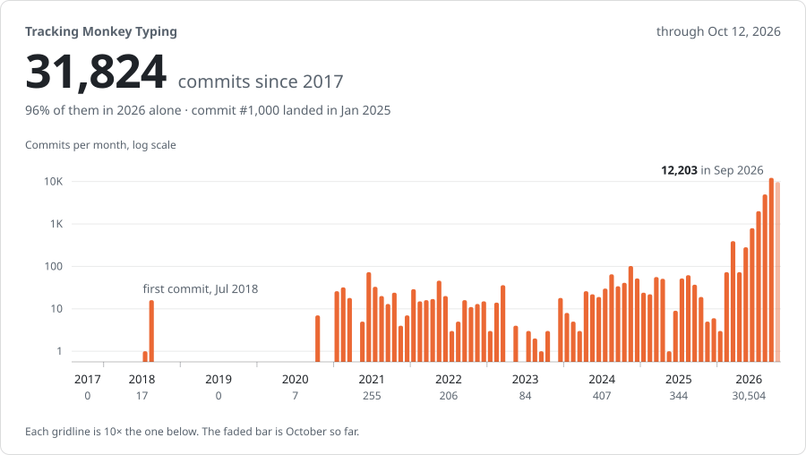

# Greeting, visitors  😄

#### Sirui is pronounced as <strong>"three"</strong>.

## Tracking Monkey Typing

<a href="https://dylantao.github.io/github-activity/">
  <picture>
    <source media="(prefers-color-scheme: dark)" srcset="./assets/github-metrics-dark.svg">
    <source media="(prefers-color-scheme: light)" srcset="./assets/github-metrics.svg">
    
  </picture>
</a>

_One monkey, one keyboard: every commit I've landed on the default and Pages branches of the repos I own or work in, private ones included. The log scale is the only way 2026 fits on the same chart as everything before it. GitHub's green calendar also counts PRs, issues, and reviews, so it won't match exactly._

<!--
### Stats for nerds

-->
