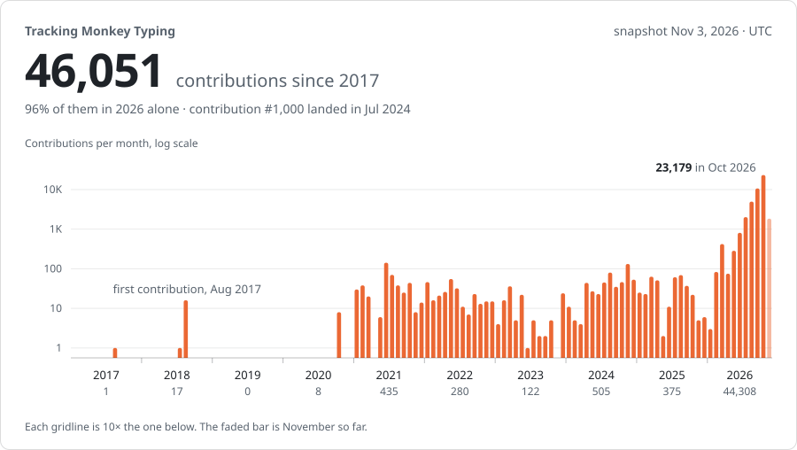

# Greeting, visitors  😄

#### Sirui is pronounced as <strong>"three"</strong>.

## Tracking Monkey Typing

<a href="https://dylantao.github.io/github-activity/">
  <picture>
    <source media="(prefers-color-scheme: dark)" srcset="./assets/github-metrics-dark.svg">
    <source media="(prefers-color-scheme: light)" srcset="./assets/github-metrics.svg">
    
  </picture>
</a>

_One monkey, one keyboard: the contributions GitHub credits on my green calendar, private activity included as a count. Each year's total matches that calendar at the dated snapshot; today's count can keep growing. The log scale is the only way 2026 fits on the same chart as everything before it._

<!--
### Stats for nerds

-->
